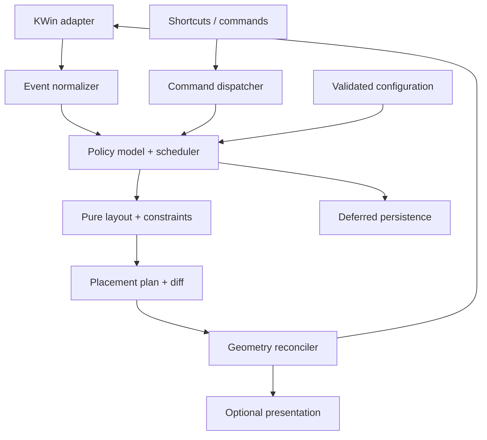

# Proposed runtime architecture

## 1. Objectives and invariants

Plastile is a tiling policy integrated with KWin. It must remain responsive during rapid commands and window churn, converge under asynchronous application resizes, and be easy to configure without putting parsing or UI work on the command path.

The following invariants are normative:

1. A live window has one record and at most one active placement owner.
2. A layout leaf references a live eligible window or an explicitly retained placeholder; no accidental ghost leaves.
3. Context keys include stable identity and are never inferred from the current desktop during a delayed callback.
4. Every layout solve is pure with respect to KWin; only the adapter writes external state.
5. Desired, last requested, and observed rectangles are separate values.
6. No identical geometry request is repeated while the same valid request is outstanding, except a diagnosed bounded stale-ack correction.
7. Structural events are never discarded merely because a layout is applying.
8. Unloading invalidates every callback before resources are released.
9. Infeasible constraints produce a deterministic exception/fallback, not an unbounded fight.
10. Optional persistence, settings UI, and presentation cannot block the first response to a normal command.

## 2. Runtime components



The arrows carry immutable values or normalized events. Live Qt objects remain behind the adapter. Presentation receives placement revisions but cannot alter the authoritative layout. Persistence receives snapshots and cannot mutate model state without an explicit versioned restore command.

As implemented (T27, [ADR-020](DECISIONS.md#adr-020-persistence-goes-through-an-asynchronous-d-bus-helper)): persistence lives in a separate process, the `plastile-state` helper on the session bus, which owns the two state files. KWin's thread only builds a snapshot and hands it to KWin's asynchronous `DBusCall` (`package/contents/ui/Persistence.qml`); it never reads or writes the files and never waits for a reply. The saved state arrives after the first solve, as one reply, and is applied as a restore (context preferences and float preferences) that re-solves through the ordinary flush; user decisions made before it arrived win.

## 3. Suggested repository structure after implementation begins

| Path | Responsibility |
|---|---|
| `src/core/model/` | Window/context records, IDs, ownership, state transitions |
| `src/core/events/` | Normalized events and coalescing rules |
| `src/core/commands/` | Typed command validation and execution |
| `src/core/layouts/` | Master/stack, BSP, monocle; later scrolling/zone models |
| `src/core/geometry/` | Rectangles, cut allocation, minima, feasible ratios |
| `src/core/scheduler/` | Dirty sets, apply depth, revision scheduling |
| `src/core/reconcile/` | Placement diff, request ledger, bounded convergence |
| `src/config/` | Schema, defaults, precedence, rule compilation |
| `src/adapters/kwin/` | Live objects, capability profile, signal registry, API wrappers |
| `src/diagnostics/` | Bounded trace/counters and explanation data |
| `package/contents/ui/` | Declarative root, shortcut owners, lazy UI |
| `package/contents/code/` | Generated runtime module; build policy decides whether committed |
| `tests/core/` | Pure model/layout and property tests |
| `tests/replay/` | Recorded normalized event fixtures |
| `tests/integration/` | Nested-session fixtures and independent observations |
| `bench/` | Microbenchmarks, compositor workloads, summaries |
| `tools/` | Build/package/install-in-test-session and result processing |
| `native/` | Created only if an accepted ADR requires a narrow native component |

Do not create every directory as empty scaffolding. Add modules when their task begins. Pin build dependencies and validate produced modules in actual KWin.

## 4. IDs, contexts, and object lifetimes

### Session identity

Assign a `WindowId` from the runtime's stable session identifier if reliably exposed; normalize it to a string and add an instance/generation token. Never use title, resource class, or array index as the live primary key. A record can outlive a native callback only as inert data; dereferencing a removed Qt wrapper is forbidden.

Maintain `Map<WindowId, WindowRecord>` in the model and a separate adapter registry from ID to live object plus connection handles. On removal, tombstone the ID/generation immediately, stage structural cleanup, cancel requests and delayed work, and drop live references. Retain only bounded diagnostic data.

### Context identity

`ContextKey = { outputId, desktopId, activityId }`.

Output identity is independent of enumeration order. The adapter records available UUID/name/connector information and topology generation. Replug matching may need a persisted preferred output key; ambiguous identical monitors require a deterministic fallback and diagnostic, not silent identity reuse. A context stores a layout type, layout state, ordered eligible IDs, focus history, configuration revision, dirty reason bits, and model/layout revisions.

As implemented (T30): KWin exposes no output UUID to scripts (API_PROFILE E16), so the key is `edid:<manufacturer>/<model>/<serial>` when KWin reports a manufacturer or model, and the connector name otherwise (the virtual backend). Identical monitors (equal triples) add `@<connector>` and are reported once as ambiguous; when such a twin comes or goes while the other stays connected, the engine re-keys that output's contexts and memberships in place (`outputsRekeyed`). User overrides keep matching the connector name (`outputName`). A context left without members is collected at the end of a flush; what it holds beyond the configuration (an explicit layout, a master ratio/count set by command) is kept in a bounded map (64 entries, oldest dropped) and restored when the context is used again. `Engine.contextPreferences()` is the accessor for persistence, since contexts themselves may be collected.

Desktop IDs are stable within the exposed API; display names and positions can change. Activities may be absent/disabled; normalize an explicit default activity. Confirm the all-activity representation at M0. Full context keys accompany every delayed operation and persistence record.

### Configuration and topology revisions

Separate `instanceEpoch`, `topologyEpoch`, `configRevision`, `contextRevision`, and per-window `lifetimeGeneration`. A delayed callback captures the relevant tokens and validates them before reading or applying. Do not use a global revision to invalidate all windows on every keypress; choose the narrowest token that captures the dependency.

## 5. Window record and ownership

The following types are design pseudocode, not existing KWin APIs:

```ts
type PlacementMode = 'excluded' | 'floating' | 'tiled';
type Suspension = 'minimized' | 'fullscreen' | 'maximized' | 'moving' | 'resizing';

interface WindowRecord {
  id: string;
  lifetimeGeneration: number;
  mode: PlacementMode;
  suspensions: Set<Suspension>;
  context: ContextKey | null;
  metadata: WindowMetadata;
  constraints: WindowConstraints;
  desired: Rect | null;
  observed: Rect;
  request: GeometryRequest | null;
  floatingRestore: RestoreRecord | null;
  propertyOwnership: PropertyOwnership;
  ruleDecision: ExplainedRuleDecision;
}
```

Use orthogonal suspensions rather than an exploding enum containing every maximize/minimize/fullscreen combination. Transition methods enforce legal combinations. A user drag temporarily owns the observed frame; a minimized/fullscreen window retains its structural preference but receives no ordinary tile geometry.

Property ownership records original border/layer values, last Plastile-applied values, and the revision that applied them. On float/unload, restore only if the current value still equals the value Plastile owns. If the user changed it, yield. Similar reasoning applies to floating rectangles: do not overwrite a user-resized float with an old snapshot.

## 6. Normalized events

Convert KWin-specific signals into a stable vocabulary:

| Event | Essential payload | Handling |
|---|---|---|
| `WindowDiscovered` | ID, generation, metadata snapshot | Classify; adopt only when eligibility and context are known |
| `WindowRemoved` | ID, generation, previous contexts | Tombstone now; remove leaves and requests; invalidate affected contexts |
| `WindowMetadataChanged` | ID, changed fields | Reevaluate cached rule decision only if relevant |
| `WindowMembershipChanged` | old/new memberships and topology epoch | Move between explicit contexts; no global current-desktop lookup later |
| `WindowObservedGeometry` | ID, value rectangle, timestamp, generation | Reconcile request or interactive state; no automatic unconditional solve |
| `WindowInteractiveStarted/Ended` | ID, move/resize, start/end observation | Transfer geometry authority, convert accepted resize into layout parameters |
| `WindowStateChanged` | minimize/fullscreen/maximize/visibility | Update suspensions and restore paths |
| `ActiveWindowChanged` | old/new ID | Update focus history; solve only for focus-dependent layout/presentation |
| `ContextVisibilityChanged` | output, old/new desktop/activity | Activate stored model and invalidate only required contexts |
| `OutputTopologyChanged` | snapshot and epoch | Reconcile identities, migrate safely, recompute work areas |
| `WorkAreaChanged` | output/context, usable rectangle | Invalidate geometry without reconstructing policy order |
| `ConfigurationActivated` | validated snapshot and revision | Atomically install; derive affected contexts and rules |
| `NativeTileEdited` | owned root identity and revision | Only in a chosen native backend; reconcile according to ownership mode |

Some APIs do not provide every signal directly. The adapter may derive an event from a supported related signal and compare cached snapshots. Document each derivation and its cost; do not introduce a permanent timer to compensate for missing research.

### Coalescing rules

- Repeated geometry observations for one live generation can retain the latest observation for reconciliation, but interactive boundary events remain ordered.
- Multiple metadata changes merge changed-field sets and use the latest snapshot.
- A create followed by remove before adoption cancels without a solve or stale object access.
- Removal dominates subsequent stale events for the same generation.
- Multiple dirty reasons union per full context key.
- Membership transitions preserve old and new contexts; neither side is inferred later.
- User commands are not generally idempotent: two “increase ratio” commands must not collapse into one. Convert repeats to an accumulated delta only when semantics are identical and order with other commands is preserved.
- Focus changes can update the final active ID, but focus commands and activation requests must preserve their user-visible ordering/denial semantics.

Implement indexed coalescing with maps/sets and bounded queues. Avoid repeatedly searching an ever-growing event list. Set a diagnostic threshold for unexpected queue growth and dump a bounded trace; do not silently discard important events.

## 7. Scheduler and transaction protocol

Use three work classes:

1. **Commands:** focus, swap, ratio step, toggle float, layout change. Immediate when safe.
2. **Lifecycle convergence:** related window/state/topology notifications. Coalesce into one scheduled flush.
3. **Maintenance:** persistence, UI refresh, diagnostic export, bounded settle/deadline checks. Off the response path. Persistence is one debounced, asynchronous request to the helper process (ADR-020); its file I/O never runs on KWin's thread.

Pseudocode:

```text
onCommand(command):
  validate instance and command target
  if applyingDepth > 0:
    orderedCommands.push(command)
    ensureFlushScheduled()
    return
  drain necessary staged structural events
  apply command to model
  solve and apply dirty visible contexts once

onSignal(signal):
  snapshot safe values and normalize
  tombstone removals immediately
  if applyingDepth > 0:
    record expected observations or stage essential changes
  else:
    reduce event into model
  mark affected full context keys
  ensureFlushScheduled() with one stable callback

flush():
  reject stale instance epoch
  consume scheduled flag before processing
  reduce staged events and ordered commands
  snapshot dirty contexts and clear consumed reasons
  solve/diff/apply those contexts
  if new invalidations arrived, schedule one further flush
```

Do not recursively flush from within a geometry write. Apply depth must use `try/finally`. An error is attached to the current transaction; the model remains recoverable and future commands can still run. If one context fails, quarantine that context/window and preserve others.

### Solve/apply transaction

1. Snapshot immutable model inputs and the relevant revisions.
2. Compute slot rectangles and constraints in pure code.
3. Validate finite, positive, feasible output and no unintended overlaps.
4. Build a placement plan containing window ID/generation, context/revision, target frame, state-property diffs, and optional focus intent.
5. Compare the plan to current desired/requested state, not only observed frames.
6. Enter apply guard; register all outgoing intents before the first external write.
7. Apply only changed owned properties and changed frame targets. Avoid border/layer writes when unchanged.
8. Leave guard; reduce staged structural events and schedule reconciliation if needed.
9. Publish a compact presentation event and defer persistence/diagnostic formatting.

This is a logical transaction, not an atomic compositor-wide frame commit. Independent Wayland clients acknowledge at different times. The UI and documentation must not imply atomic physical presentation.

## 8. Geometry request ledger and convergence

Each request records `{instanceEpoch, windowGeneration, contextKey, contextRevision, sequence, target, issuedAt, cause, correctionCount}`. Keep a bounded history of recent targets for late-observation recognition, not an unbounded log.

### Ordinary outcomes

- Observed approximately equals current target: mark request settled at the observation layer; do not label it presented.
- Observed equals a previous target while a newer target remains outstanding: classify as an older observation; do not change policy. Wait for a relevant event/deadline before a correction. The exception is a newer request KWin never forwarded: KWin sends a configure only for a size other than the committed one, so a request whose size equalled the frame read just before it was written (the return-to-A case, E04) is corrected once on the late commit. Any other newer request has its own configure in flight, and re-sending it would only duplicate that configure (measured as burst write amplification, D8).
- Observed reflects an active user resize: update interaction state, not the request completion state. On release, map the accepted boundary movement to layout ratios and solve once.
- Observed differs because constraints were learned: update accepted constraints and recompute the affected context once.
- Observed differs after an explicit external/native tiling action: yield according to behavior policy instead of snapping back forever.
- A window is removed or leaves the context: invalidate the request before any delayed action.

### Script visibility limit

A script's own sequence is not the xdg configure serial. Do not claim perfect attribution of every signal to a protocol request. If the public API cannot disambiguate a sequence, use conservative pending intent, observed values, and a bounded deadline. A native bridge can provide better request/commit evidence only after M1/G1 proves it is needed.

### Bounded correction policy

Initial proposal: at most two corrective geometry writes per window for one unchanged policy target, with no continuous polling. Use an event-driven correction and a single deadline check if necessary. The timeout is a convergence deadline, not a delay before first response. Record why each correction occurred. If still divergent, mark `constraint-or-client-divergence`, retain the window safely visible/floating, and expose an explanation. Tune the exact timeout and correction count in M1/M3 using controlled slow clients; do not silently grow them until tests pass.

Rapid A→B→A reversals require special testing because an outstanding B configure can later commit after a return-to-A request. The desired/requested ledger must not skip return-to-A merely because the observed frame is still A. Test this independently in both backend prototypes.

## 9. Layout and constraint contracts

```ts
interface LayoutEngine<S> {
  insert(state: S, window: WindowInput, intent: InsertIntent): S;
  remove(state: S, id: WindowId): S;
  command(state: S, command: LayoutCommand): S;
  solve(state: S, input: SolveInput): SolveResult;
}
```

The exact mutable/immutable implementation can be optimized later, but public contracts use value inputs and deterministic results. `SolveResult` includes slots, explained exceptions, feasible parameter clamps, and ordering/focus metadata. It does not contain live Qt objects or perform side effects.

### Master/stack

Preserve explicit window order and master count. Allocate a master area and stack area using a ratio constrained by aggregate minima; each area's vertical partition uses shared cut coordinates. Single-window fill and optional centered width are policy settings. Inserting a new window must preserve existing order unless a configured placement mode says otherwise.

### Persistent BSP

Stable node IDs represent branches and leaves. Branches have axis and ratio; leaves reference window IDs. Insert relative to focused/selected leaf; alternate or choose an axis according to configuration. Removing a leaf collapses its parent, preserving sibling substructure. Aggregate min/max feasibility bottom-up; clamp divider movement without flattening the tree. Rotate/mirror operations transform structure predictably and preserve IDs where possible. A focus change never rebuilds the tree.

### Monocle

Retain all eligible IDs and their order; select one visible/raised member according to explicit policy. Avoid minimizing other windows just to hide them unless that mode is deliberately chosen and its taskbar/restore consequences are tested. The initial implementation can stack full-area frames while respecting focus/visibility; it must not hide unrelated floating dialogs behind tiled windows.

### Floating and exceptions

Floating is a first-class mode with geometry restore, not a failed tile. System surfaces are excluded, not floating managed clients. Constraint overflow can float a window with an explanation and retry only when input conditions change. Do not rerun expensive rule parsing on every solve.

## 10. Native backend contract if selected

Keep the pure model unchanged. A `NativeTileProjector` maps stable model nodes to native nodes for one owned output/desktop root. On each transaction it computes structural operations, geometry changes, and membership changes. It validates native objects before use and invalidates all mappings on root replacement/topology changes.

Required rules:

- Root ownership is explicit and exclusive while the mode is enabled.
- Existing native layout is snapshot/adopted or preserved according to a documented user action; no silent deletion at startup.
- Native-editor open/edit either enters an explicit manual mode, adopts compatible changes into the model, or temporarily suspends automatic policy. There must not be two-way uncontrolled feedback.
- Use the native coordinate/padding conventions verified in the selected release.
- Minimize structural edits; avoid destroying all children for a ratio change.
- Call `manage/unmanage` only when association changes. Check return values.
- Shared activity roots require projecting only the active activity's model and saving its logical structure before a switch.
- No-op transactions produce zero native mutation operations.
- Teardown restores only owned state and handles windows/tiles destroyed during restoration.

The prototype should count splits, removals, native geometry writes, membership changes, emitted observations, and protocol configures separately. If mutation count is excessive, optimize the projector or retain the direct backend.

## 11. Configuration and command boundaries

See [configuration](CONFIGURATION.md) for the schema. Compile rule matchers and override resolution into an immutable `ConfigSnapshot`. Cache decisions against metadata/config revisions. Commands carry explicit targets: current focus/output is resolved once at dispatch, not again after a delay. All frontends invoke the same command dispatcher.

A settings panel can request a validated activation but cannot write live geometry directly. A CLI/D-Bus interface is optional and must map onto typed commands, reject stale/invalid IDs, and return accepted/completed status accurately. Do not expose a generic evaluate-JavaScript endpoint as the configuration interface.

## 12. Performance architecture

The desired common-case complexity is O(n) for solving one affected context with n tiled windows, O(1) record lookup and dirty marking, and O(n) geometry diff/application. BSP insertion/removal may be O(h), where an unbalanced tree has h up to n; do not promise logarithmic behavior without a balancing policy. Navigation can begin with O(n) scoring and be indexed only if measured necessary.

Prefer fewer crossings and mutations over clever arithmetic optimizations. Cache immutable configuration/rule results; use context-local window lists; avoid serializing full desktop state per keypress; avoid recreating timers or UI objects in the common path; keep diagnostic formatting lazy; do not force garbage collection during interaction. Track allocation pressure and tail latency in the actual Qt runtime.

Performance gates and clocks are specified in [PERFORMANCE.md](../validation/PERFORMANCE.md). A native migration must retain the same normalized fixtures and behavior tests so changing the language cannot hide semantic regressions.

## 13. Failure and recovery

If one callback throws, decrement guards in `finally`, annotate the failing transaction, and reconcile from a safe model snapshot. If one layout returns invalid geometry, keep the last valid placement or float affected windows within the work area. If an output disappears, cancel its requests before migration. If configuration is invalid, retain the last valid revision. If persistence/helper fails, continue in-memory operation. If presentation fails, disable the effect and keep instantaneous geometry.

Provide a user-visible suspend action that releases ownership without killing applications or restarting the session. A debug “reconcile” command may rebuild model membership from the live window inventory, preserving explicit float decisions where possible. This recovery path is not a substitute for correct incremental events; invoking it routinely is a defect.
