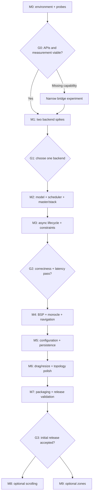

# Implementation roadmap

## 1. Delivery contract

Build a fast, stable tiling policy for KDE Plasma with clear configuration and a reproducible performance story. Preserve KWin and ordinary KDE behavior. Performance and snappiness are primary requirements, so instrumentation and geometry correctness precede extra layouts, animations, and settings polish.

This roadmap is intentionally ordered by uncertainty reduction. The first deliverable is not a large framework: it is a small running prototype and evidence that the chosen integration can satisfy the user-visible behavior. All proposed budgets and feature names must be reconciled with the actual target machine during M0/M1.

The existing repository contains research/plans only. Treat the [source dossier](../research/STATE_OF_THE_ART.md), [KWin model](../research/KWIN_INTERNALS.md), [architecture](../design/ARCHITECTURE.md), [behavior](../design/BEHAVIOR_SPEC.md), and [performance protocol](../validation/PERFORMANCE.md) as implementation inputs. Use the task IDs in the [backlog](BACKLOG.md) for work tracking.

## 2. Milestone dependency map



The graph is a logical dependency map, not a schedule estimate. Do not promise a fixed completion date before integration feasibility and target environments are established.

## 3. M0: environment discovery, source refresh, and capability evidence

**Purpose:** eliminate guessed APIs and establish measurement before architecture hardens.

**Tasks:** T00–T04.

**Work:**

1. Record OS/distribution, packaged KWin/Plasma/Qt/KF versions, session type, hardware, compositor renderer, output layout/scales/refresh, VRR, effects, rules, and shortcuts. Record whether tests run nested, virtual, or physical. Do not substitute the source snapshot's version for the installed package.
2. Read relevant current source at the target version and refresh the inaccessible Codeberg homes if possible. Preserve the original research pins and record new pins separately. Check modern `rootTile`, `manage/unmanage`, per-output desktop, window property, and shortcut behavior against runtime probes.
3. Build the smallest declarative package that logs one discovery event, registers a disposable shortcut, places one controlled test window, and unloads cleanly. No automatic adoption of the user's whole desktop.
4. Establish how to collect monotonic timing: native test harness/QML profiler or a narrow measurement bridge; calibrate coarse script clocks. Record which pipeline stages are observable without native integration.
5. Build a controlled client fixture: configurable min/max size, delayed configure response/commit, application-initiated resize, transient child, and distinct rendered marker for each request. Use existing tools if they satisfy the same controls; otherwise create a small Qt/Wayland test client.
6. Collect a no-tiler baseline and choose comparable upstream baselines from the installed-compatible projects. Install one at a time in a disposable session. Keep visual effects identical when measuring geometry paths.

**Deliverables:** `docs/status/ENVIRONMENT.md`, a machine-readable capability profile, exact source/version refs, fixture build instructions, baseline raw data, and a short probe report. These files are created by the implementing agent, not present in the planning commit.

**G0 acceptance:** a controlled window can be observed and positioned; unload removes callbacks/shortcuts; basic timestamps can be interpreted; output/context APIs are known; no assumed internal C++ method is masquerading as a script API. If a capability is missing, document a minimal reproducer and complete a narrow bridge or revised support decision. Pure core work may continue independently, but G0 cannot be marked passed by mocks.

**Scope cap:** do not build the full settings UI, every layout, or a generic plugin system here.

## 4. M1: direct/native prototypes and backend decision

**Purpose:** resolve the largest architectural uncertainty with the same workload and core.

**Tasks:** T05–T08.

**Direct prototype:** three controlled windows, master/stack rectangle calculation, one shortcut to change ratio/swap, one geometry writer, request ledger, stable deferred invalidation, and teardown. Track total solves, property writes, geometry observations, outstanding requests, and handler duration.

**Native prototype:** same fixture and target rectangles represented by a small native tree. Use native association methods and preserve stable nodes for ratio changes. Count splits/removals/relative changes/manage calls. Explicitly select a disposable root; do not erase a real user's native layout.

**Required experiments:**

| Experiment | What it resolves |
|---|---|
| No-op ratio/layout command | Whether a no-op produces writes, solves, or native mutations |
| Rapid A→B→A sizes with delayed client commit | Whether request and observation state are correctly separated |
| Burst create/remove | Whether scheduling coalesces and removals cancel stale adoption |
| Minimum-size client | Whether constraints cause oscillation or mutation churn |
| Maximize/fullscreen/restore | Whether the chosen owner cooperates with KWin state |
| Native quick-tile and Meta+T edit | Ownership conflicts and integration behavior |
| Output transfer/unplug | Context identity and delayed callbacks |
| Repeated enable/disable with pending work | Instance and resource lifetime |

**G1 decision record:** update ADR-003 with exact tested versions, fixture/workload, raw data, counters, failures, selected backend, rejected alternatives, and remaining limitations. Evaluate correctness first and p95/p99 responsiveness second. A smaller solver time does not excuse a geometry race or a slower first visible response.

**Default rule:** retain direct geometry if it meets behavior and latency requirements and native tiles do not provide a material advantage. Select native tiles if their semantics address reproduced failures and the measured application path remains acceptable. If neither works through public scripting APIs, run a narrowly scoped native spike for the proven missing capability. Do not rewrite all policy in C++ before the spike proves the necessity and benefit.

**Deliverables:** prototype evidence and an executable regression fixture for every failure. Keep prototype code isolated or remove it once the production backend is selected. Do not ship two active geometry owners.

## 5. M2: production core, scheduler, and minimal automatic tiling

**Purpose:** turn the winning spike into a clean model rather than growing a prototype into a monolith.

**Tasks:** T09–T14.

**Work:**

- Implement stable IDs, full context keys, live-object registry, orthogonal suspension state, property ownership, and configuration/topology revisions.
- Define normalized events and typed commands. Resolve focus/output targets at dispatch. Preserve structural events during apply; use maps/sets for coalescing.
- Implement immediate command and deferred lifecycle lanes with one stable flush callback. No recurring idle timer.
- Implement pure master/stack solve and shared-edge rounding. Add gaps, master count/ratio, stable order, floating restore, and deterministic overflow.
- Implement placement plan validation/diff and the chosen adapter. Record outgoing intent before external writes.
- Add bounded in-memory traces/counters and deterministic replay fixtures.

**Acceptance:** controlled automatic open/close, swap, ratio change, focus, and float work in one output/context; focus-only commands issue no geometry requests; no-op plans issue no geometry/property writes; a burst converges without solve-per-signal behavior; all callbacks can be torn down. Core and replay tests pass, and actual-KWin transaction measurements meet provisional budgets on the reference fixture.

**Required review:** inspect every external geometry/property write. It must go through the adapter/reconciler and carry a reason/revision. Search the code for frame assignment/native mutation outside the approved module. Review allocations/crossings only after behavior is correct.

## 6. M3: asynchronous lifecycle, constraints, and convergence

**Purpose:** make it safe for real applications, including slow or awkward ones.

**Tasks:** T15–T20.

**Work:**

- Complete requested/observed geometry tracking, old-target recognition, reversal handling, bounded corrections, and diagnosed fallback.
- Complete minimize/fullscreen/maximize suspensions and restoration, including overlapping states and app-driven changes.
- Add classification and transient policies; exclude helpers/system surfaces before expensive signal hookups.
- Implement min/max feasibility and learned constraint handling. Validate fixed-size and XWayland behavior without claiming access to unavailable hints.
- Handle create/delete within one turn, removal during apply, late metadata, reclassification, and removed-object callbacks.
- Test no-tiler/native quick-tile cooperation and explicit ownership yielding.

**G2 acceptance:** the asynchronous fixture suite passes with delayed/out-of-order observations and rapid reversal. No infinite correction loop, no stale ID writes, no window trapped invisible, no shell helper adopted. Correction counts remain bounded; one slow window does not delay peers. The negative tests deliberately throw inside callbacks to prove guards recover.

**Performance gate:** repeat the M1 workloads with instrumentation disabled and enabled separately. Explain any p95/p99 regression. Do not add layouts until unexplained extra solves or geometry writes are resolved.

**Deliverables:** failure-specific replay traces, actual compositor integration results, a constraints/exception explanation surface (text diagnostics sufficient), and an updated limitations register.

## 7. M4: complete initial layout and command set

**Purpose:** provide useful tiling-manager behavior on the verified foundation.

**Tasks:** T21–T24.

**Work:** persistent BSP with stable node IDs, insert/remove/collapse/rotate/mirror, feasible divider resizing, monocle, directional navigation, swap versus structural move, and reliable cross-output/desktop commands. Master/stack and floating remain reference behaviors.

**Acceptance:** tree invariants survive randomized operation sequences; unchanged subtrees preserve IDs/order; focus changes do not rebuild geometry in ordinary layouts; swap and reinsert have distinct predictable semantics; monocle does not minimize unrelated windows or hide transients; context changes preserve layout preferences. Each layout runs through the same constraints and placement protocol.

**Scope cap:** no scrolling/zone editor/custom executable plugins. Additional decorative layouts require evidence that they do not weaken core quality.

## 8. M5: configuration, rules, and durable preferences

**Purpose:** make behavior configurable without making interaction expensive or ambiguous.

**Tasks:** T25–T28.

**Work:** versioned schema, strict validation, default generation, ordered overrides/rules, matcher caching, rule explanations, atomic activation, settings reload, stable shortcut IDs/conflict handling, and minimal persistence. Add a small lazy settings UI after the data path works. Select a supported settings/helper bridge if the script lacks required I/O; keep runtime geometry independent of it.

**Acceptance:** invalid input never replaces the last valid revision; field-level precedence is deterministic; title changes do not rerun unrelated matchers; config activation performs the minimum required invalidation; reload produces one engine and one command handler; helper loss preserves operation; restored floating geometry comes from floating use rather than a tiled frame; migration fixtures pass.

**Performance gate:** compare exact/glob rules with a realistic large rule set, and report regex limitations. Rule compilation/loading is excluded from ordinary command timing but separately measured as activation work. A config update must not block the compositor long enough to cause noticeable stalls; large parsing work belongs outside KWin when needed.

## 9. M6: interaction and topology polish

**Purpose:** cover the transitions that make a desktop feel trustworthy.

**Tasks:** T29–T31.

**Work:** drag previews and release commit, shared resizing, user cancellation, mixed-scale outputs, per-output current desktops, work-area changes, docking/undocking, output reordering, suspend/resume, and visibility recovery. Pointer sampling exists only during active interaction. Keep geometry derived from the model, not the overlay scene graph.

**Acceptance:** a drag does not force a full reflow per pixel; a user resize is not fought; cancellation clears all previews/timers; unplug leaves windows visible; monitor identity does not depend on index; delayed callbacks from the previous topology do nothing; native editor/quick-tile actions obey the chosen ownership mode.

**Performance gate:** active resize has bounded solves/request counts and does not introduce avoidable extra frame intervals compared with the matched baseline. Test different refresh rates and VRR separately. Do not infer high-refresh performance from a nested 60 Hz recorder.

## 10. M7: packaging, documentation, and initial release

**Purpose:** ship the automatic tiler with truthful support and performance claims.

**Tasks:** T32–T35.

**Work:** reproducible builds, correct KWin package metadata, install/update/remove scripts scoped to test or user-approved paths, dependency/version checks, distribution packaging, documentation, shortcut help, troubleshooting, diagnostics export, regression CI, and a full release matrix. If native code is present, build against each actual target KWin and test plugin load/unload; source compatibility is insufficient.

**G3 acceptance:** all initial mandatory test scenarios pass on the declared support versions; physical-session smoke and input-to-visible tests are complete; long-session churn and repeated reload show no growing resource counts; trace export is bounded/redacted; package removal releases all owned state. If physical validation is unavailable, label the build a candidate and list the missing gate.

**Release evidence:** publish hardware/software, workloads, baselines, clocks, percentiles, raw-result location, and confidence/limitations. State engine speed, command-to-request, observation, and presentation results separately. Do not claim “fastest KDE tiler” without a reproducible matched comparison across relevant alternatives.

**Initial release feature boundary:** master/stack, BSP, monocle, floating, keyboard commands, window rules, scoped settings, correct topology/lifecycle, and measured responsiveness. Animation is optional and disabled by default; it must not hold up this release.

## 11. M8: optional scrolling mode

**Prerequisite:** G3 passed. **Task:** T36.

Write a dedicated scrolling behavior addendum first: per-output strips, columns, preferred widths, centered/lazy policies, vertical stacking, focus/scroll coupling, pinned windows, transients, and off-screen visibility/input. Reuse the common event/ownership/reconciliation infrastructure, not the master/stack state representation.

Prototype clipping and input behavior on adjacent outputs. If a script cannot prevent off-screen windows from interacting with neighboring outputs or becoming invisible incorrectly, make that a named limitation and evaluate a small effect. Add frame-synchronized optional animation only after instantaneous scroll placement passes correctness. Test rapid reversals and disable mid-transition.

**Acceptance:** no unintended off-screen input, no permanent opacity changes, no stale column state, predictable multi-output movement, and performance evidence for focus/scroll under many windows. This is a separate release gate, not a promise of niri-equivalent capabilities from a script.

## 12. M9: optional manual zones and layout authoring

**Prerequisite:** G3 passed. **Task:** T37.

Add a pure normalized zone model, keyboard zone commands, optional overlay/selector, and later an editor. UI and keyboard geometry must agree exactly. Keep overlay creation lazy and pointer tracking visible-only. Support model-derived previews; do not let the QML item hierarchy become the geometry database.

Custom declarative split/zone layouts have bounded node/zone counts and validation. Executable extensions require a separate isolation/resource-limit decision. A zone editor is not required to prove the automatic tiler's performance.

## 13. Native migration gate G4, if needed

This is an alternative path triggered by evidence, not a mandatory final phase.

1. Write a minimal reproducer showing the script API gap or dominant measured cost.
2. Identify the narrowest intervention: timing probe, requested-geometry bridge, transform effect, or full policy runtime.
3. Implement a disposable native spike on exact target KWin versions, with a failure/unload path.
4. Replay identical fixtures and compare end-to-end latency, request counts, frame pacing, memory, and correctness.
5. Account for build/distribution/ABI maintenance and failure recovery.
6. Accept migration only when it resolves the limitation and the product remains maintainable. Keep the pure model/test fixtures portable. Rewrite production policy once, deliberately, rather than maintaining two diverging solvers indefinitely.

## 14. Milestone completion template

Every milestone handoff records:

```text
Milestone and task IDs:
Implementation commit:
Exact environment/capability profile:
Behavior implemented:
Tests run and independent oracles:
Performance workload, clocks, raw data, percentiles:
Counter deltas and unexplained outliers:
Teardown/reload evidence:
Failures and limitations:
Decision records changed:
Next eligible task:
```

“Implemented” without executable evidence is not completion. An unavailable physical test is an open gate, not a pass. A fix that introduces a fixed timer needs the reproducer, reason, deadline, cancellation, regression test, and measured latency impact recorded alongside it.
