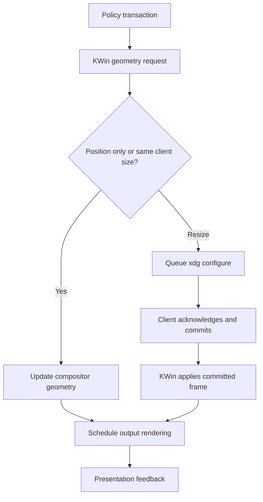

# KWin and Plasma implementation model

## 1. Version boundaries and evidence

The development snapshot declares KWin `6.8.80`. Separate release-branch snapshots declare `6.7.5` and `6.8.1`. All three were inspected; source version strings do not establish the user's installed version. The proposed support family is Plasma 6 Wayland, initially validated on the 6.7 and 6.8 API families. M0 must select actual packaged builds and record their patch versions.

Use the release profiles in the [source index](SOURCE_INDEX.md#release-profiles), especially [6.7 workspace](SOURCE_INDEX.md#k67-workspace), [6.7 window properties](SOURCE_INDEX.md#k67-window), [6.8 workspace](SOURCE_INDEX.md#k68-workspace), and [6.8 window properties](SOURCE_INDEX.md#k68-window). Older generated scripting references can lag current source. A method in a C++ header is script-callable only when exposed through a property, invokable, slot, registered type, or wrapper; public C++ visibility alone is insufficient.

## 2. Responsibilities in a Plasma Wayland session

`plasmashell` supplies desktop surfaces, panels, launchers, widgets, and shell UI. KWin manages top-level windows, input routing, focus/stacking, outputs, virtual desktops, window rules, decorations, effects, and composition. KWin is also the Wayland server. Applications own their surface contents and participate in resize/configure negotiations. A tiling policy runs above that machinery; it does not make all application rendering synchronous.

Consequences:

- A KWin script is in-process policy code. It does not need a network service or an external Wayland client to reposition normal windows.
- Long script callbacks and native effect work can interfere with compositor-sensitive work. Some rendering paths have their own threading details, but that does not make blocking workspace callbacks safe.
- A normal external Wayland client cannot assume authority to position every other client's toplevel. Window enumeration protocols do not automatically grant arbitrary geometry control. A daemon needs an authorized KWin-side integration if it owns policy.
- A C++ effect can access internal KWin objects that a script cannot, but pays build/runtime compatibility and crash-surface costs.
- XWayland windows are X11 clients managed inside the Wayland session. Supporting them differs from supporting an entire X11 Plasma session.

The initial design preserves KWin and runs inside its supported scripting integration. [Scripting implementation](SOURCE_INDEX.md#kdev-scripting), [window implementation](SOURCE_INDEX.md#kdev-window), and [xdg implementation](SOURCE_INDEX.md#kdev-xdg) support this model.

## 3. Two scripting entry points

KWin supports JavaScript-based scripts and declarative/QML scripts. The inspected source uses `QJSEngine` for ordinary scripts and a QML component/context for declarative scripts. The APIs and object access conventions differ; do not mix global `workspace` examples from an old plain script with modern `Workspace` singleton use without checking the entry point.

A declarative root is appropriate for Plastile because it can supply `Workspace`, `KWin`, `Qt`, owned shortcut handlers, and lazy UI loaders to the core. Compile TypeScript to the module shape accepted by that root. The core must not depend on Node, browser DOM, `fetch`, or assumed browser timers. Build-time Node tools are fine. Probe the actual Qt JavaScript feature support and package format instead of assuming all modern TypeScript output runs on every Qt version.

Plastile should pass a small `RuntimeServices` object into the core rather than importing KWin globals throughout the codebase. That object provides snapshotting, scheduling, geometry/focus requests, capabilities, configuration activation, and diagnostics. A mock adapter implements the same contracts for deterministic tests.

## 4. Script-visible API map

| Need | Inspected modern surface | Notes for Plastile |
|---|---|---|
| Enumerate/adopt windows | Workspace window collection/list and `windowAdded` / `windowRemoved` | Probe the exact collection property/method; enumerate once on adoption, then update incrementally |
| Focus | `activeWindow` and activation signals | A focus command normally does not require a geometry solve |
| Outputs | `screens`, `activeScreen`, `screenAt(point)`, `window.output` | `window.output` is read-only in inspected headers; use the supported transfer action/wrapper |
| Per-output desktop | `currentDesktopForScreen(output)` and setter | Available in inspected 6.7/6.8; do not assume all outputs always share the global `currentDesktop` |
| Usable area | `clientArea(option, output, desktop)` or window overload | Accounts for panel reservations; full virtual screen bounds are not a substitute |
| Native tile root | `rootTile(output, desktop)` | Prefer over deprecated `tilingForScreen` |
| Native association | `tile.manage(window)` / `tile.unmanage(window)` | Verify return value; assigning `window.tile` is a deprecated compatibility path |
| Frame request | `window.frameGeometry = rect` | Property setter calls `moveResize`; observation may change later |
| Interactive state | `move`, `resize`, interactive start/finish and geometry signals | User interaction temporarily changes geometry ownership |
| Constraints | `resizeable`, `minSize`, `maxSize`, applicable type metadata | Public surface does not expose every C++ size-adjustment helper |
| Classification | normal/dialog/special flags, class/name, transient relationships | Treat helpers, panels, menus, and Plastile's UI as excluded |
| Desktop membership | `desktops`, `onAllDesktops` | Set membership, not a single integer desktop number |
| Activity membership | activity list/current activity | Probe the all-activity representation and optional Activities support |
| Shortcuts | Declarative `ShortcutHandler` or plain-script registration | Stable IDs; scoped lifetime; do not register a second path for the same command |

This table names concepts and observed symbols, not a promise that every runtime exposes identical argument types. M0 must emit a capability profile with evidence for every adapter operation. Source anchors: [workspace wrapper](SOURCE_INDEX.md#k67-workspace), [window properties](SOURCE_INDEX.md#k67-window), [tile methods](SOURCE_INDEX.md#k67-tile-header), [shortcuts](SOURCE_INDEX.md#kdev-shortcut).

## 5. Window geometry has several meanings

Keep these concepts distinct:

1. **Policy rectangle:** the slot chosen by the layout after gaps and constraints.
2. **Desired frame rectangle:** the latest target Plastile wants for a specific window and policy revision.
3. **Last requested frame rectangle:** what Plastile most recently sent to KWin, with a request generation and reason.
4. **KWin commanded geometry:** internally, `moveResizeGeometry()` can represent the outstanding request rather than the committed frame.
5. **Observed frame rectangle:** `frameGeometry`, which may lag a request while a client redraws.
6. **Client/window geometry:** application content geometry, potentially excluding server decorations and surface margins.
7. **Buffer geometry:** pixels supplied by the client, affected by scaling and viewport conventions.
8. **Visual rectangle:** where an effect is currently rendering the window while an animation runs.

A script must not assume internal commanded geometry is available as a script property. The inspected window header exposes `frameGeometry`; `moveResizeGeometry()` is a C++ method, not automatically a script API. Maintain Plastile's own requested ledger. If external state changes make that ledger insufficient, the backend experiment must expose the limitation rather than claim access it does not have.

PlasmaZones uses the internal commanded rectangle precisely to avoid treating a rapid return to the currently committed size as a no-op while a different size is in flight. That is evidence of a subtle asynchronous case, not a reason to add unconditional repeated writes. See [PlasmaZones geometry protocol](SOURCE_INDEX.md#p07-apply).

## 6. Wayland resize sequence

The following flow reflects the inspected xdg-shell implementation, with application/render/presentation stages distinguished:

`XdgSurfaceWindow` schedules configure events using a single-shot `QTimer` rather than sending each immediately. The source explains that deferring until the event loop is about to idle avoids useless configure events. `moveResizeInternal()` can update a position directly; a size change schedules configure unless the rounded requested client size equals the current client size. On acknowledge, a serial is recorded. On a surface commit, the matching pending configure is selected, geometry/states are applied, and the window can be marked mapped. See [development xdg source](SOURCE_INDEX.md#kdev-xdg) and [6.7 xdg source](SOURCE_INDEX.md#k67-xdg).

This has several practical consequences:

- A property assignment returning is not a completed resize.
- A `frameGeometryChanged` signal is not proof of pixels presented to a physical display.
- Multiple assignments in one turn may be coalesced at the protocol boundary, but still cause script calls, native tile mutations, allocations, or signals. Count both property writes and actual configures when possible.
- Late commits can observe an older request. Revision/generation tracking and bounded reconciliation are necessary.
- A slow or unresponsive application must not block placement of all other windows.
- Position-only and resize-heavy workloads should be benchmarked separately.
- Returning to the original size before an earlier request commits is a mandatory reversal test.

The xdg-shell protocol allows clients to acknowledge configure sequences and commit the appropriate state. The exact visible result also depends on toolkit behavior, size constraints, rendering load, compositor scheduling, and the output.

## 7. Native tile semantics

### Roots and scope

The inspected `TileManager` belongs to an output and maintains roots associated with virtual desktops, plus quick-tile roots. A script obtains a custom root using `rootTile(output, desktop)`. Activities are not a separate native root dimension in this interface. A policy that wants activity-specific layouts must explicitly swap/project its own activity model when the activity changes, and avoid overwriting another manager's tree.

Per-output current desktops must be considered when determining which root is active. Do not assume that a window associated with a nonvisible root should be physically resized immediately. The native implementation itself distinguishes membership from current geometry ownership. See [6.7 manager](SOURCE_INDEX.md#k67-manager) and [6.8 manager](SOURCE_INDEX.md#k68-manager).

### Relative and absolute rectangles

`Tile::relativeGeometry` is normalized. In the inspected 6.7 implementation, `absoluteGeometry()` projects it through `workspace()->clientArea(MaximizeArea, output)` and rounds logical coordinates. `windowGeometry()` then applies the tile's padding and intersects with output geometry. Documentation comments may describe a more generic screen-relative meaning; the actual source and runtime probe determine the mapping.

Do not subtract panel reservations twice. Do not apply Plastile gaps and native tile padding independently unless the design intentionally accounts for both. Do not assume `absoluteGeometry` is the final application frame rectangle: padding and constraints can differ. A script cannot automatically call every non-invokable C++ helper such as `windowGeometry()`.

### Mutation side effects

`setRelativeGeometry()` clamps against the tile minimum, checks equality, assigns the rectangle, emits relative/absolute/window geometry notifications, and resizes windows for an active tile. Custom tile mutations also adjust siblings/parents. A split or removal can change structure and invalidate retained objects. Default tile minimum size is `(0.15, 0.15)` in the inspected header; `setMinimumSize()` clamps configurable values to `[0,1]`. It is not an immutable 15% protocol limit. Probe constraints and use explicit minima rather than copying a workaround constant.

Polonium's temporary minimum sizing shows why native tree reconciliation must be instrumented. A structurally correct final tree can still cause many intermediate writes. Stable native nodes and geometry diffs should be preferred where the API permits them. See [tile implementation](SOURCE_INDEX.md#k67-tile), [custom tiles](SOURCE_INDEX.md#k67-custom), and [Polonium reconciler](SOURCE_INDEX.md#p04-build).

### Membership and request state

`Tile::manage()` rejects nonresizable/applet-popup windows, validates desktop membership, removes competing ownership for that root/desktop across outputs, adds membership, and requests the tile if active. `unmanage()` removes membership and clears the matching request. A tile can contain multiple windows; one-window-per-leaf is Plastile policy, not a universal native invariant.

The inspected `window.tile` script property reads requested tile state and has a compatibility setter. Its setter warns that writes are deprecated in favor of `tile.manage()`. Internally requested tile and committed tile are separate. The exact notification semantics must be verified on the supported release, especially during maximize/fullscreen and delayed client commits.

When native tiles are selected, Plastile must own a root by an explicit mode decision. The initial direct backend must also relinquish an existing native association before managing a window, using supported methods, and leave user quick-tiled windows alone unless the user explicitly adopts them.

## 8. Scheduling primitives and snappiness

### Immediate command path

A command can update pure state and request geometry during its shortcut callback when no transaction is already applying. For a simple focus change, use the focus adapter and return. For swap or ratio adjustment, update the relevant context, solve once, diff requests, and apply once. Heavy parsing, persistence, UI construction, or IPC must not precede that response.

### Deferred invalidation path

Several related signals often arrive for the same logical operation. Mark a context dirty and schedule one callback using an owned stable function, such as `Qt.callLater` in a declarative environment. Qt documents that calls to the same function can coalesce, with later arguments replacing earlier ones. Therefore store dirty contexts in a data structure and schedule a stable zero-argument flush callback; do not rely on the callback arguments as the event queue. Constructing a new closure/bound function for every event defeats identity-based coalescing.

`Qt.callLater` is deferred work, not a hard real-time latency guarantee. Its runtime behavior must be measured under bursts. Similarly, native `Qt::QueuedConnection` defers same-thread work; it does not automatically move work to another thread or guarantee that all future bus messages have arrived.

### Timer semantics

Qt's QML Timer documentation says it is synchronized with the animation timer and gives a usual 60 fps / roughly 16 ms example. Do not translate a configured 1 ms or 10 ms interval into a measured latency claim; neither assume every system is always 60 Hz. Test scheduling at the actual Qt/compositor/output configuration. `start()` on an already-running QML timer has no effect; `restart()` resets it. These are different batching semantics. Polonium's `start()` is not an endlessly restarted trailing debounce merely because events keep arriving; Fluid Tile's explicit restart behavior is a different case.

Use timers for deadline/maintenance paths: initial metadata that remains unavailable, invalid transient output geometry, persistence debounce, or a bounded convergence check. Each timer needs a cancellation owner, generation, reason, and maximum retry/deadline. Fixed waits must not become the normal path for focus or layout commands.

Primary references: [Qt Timer](https://doc.qt.io/qt-6/qml-qtqml-timer.html), [Qt.callLater](https://doc.qt.io/qt-6/qml-qtqml-qt.html#callLater-method), [Polonium controller](SOURCE_INDEX.md#p04-controller), and [PlasmaZones scheduler](SOURCE_INDEX.md#p07-retile).

## 9. Feedback and re-entry

KWin property changes can emit signals during the operation that changes them. A layout transaction may therefore receive geometry, border, focus, output, or tile events before its loop finishes. The original Krohnkite and Bismuth suppress nested handlers; newer implementations normalize queues or use request markers.

Plastile needs a more precise rule:

1. Record model intent and request generation before mutating KWin.
2. While applying, recognize expected geometry/property observations without recursively solving.
3. Preserve structural events such as removal, output destruction, membership change, or a user interaction beginning.
4. Stage those events/invalidations for processing after the current apply, then reconcile at most once per affected context.
5. Use `try/finally` around applying depth and owned guards. A thrown callback must not leave the runtime permanently “busy.”

Silencing all signals avoids some loops but loses information. Reapplying the desired rectangle on every geometry event retains information but can create a loop. A versioned state machine plus a bounded convergence policy avoids both extremes.

## 10. Coordinates, constraints, and work areas

Use logical compositor coordinates throughout the core. Outputs may have negative origins, unequal sizes, fractional scales, rotation, and different refresh rates. Never assume the primary output is at `(0,0)` or index zero. Store output identity separately from enumeration order.

Prefer shared-edge calculations to independent rounding: derive ordered cut positions, then subtract adjacent positions to obtain widths. This preserves total coverage even when dimensions are odd. For direct geometry use the adapter's accepted logical rectangle representation and compare scalar fields with a documented tolerance. Do not blindly multiply logical coordinates by device-pixel ratio. Physical pixel snapping, buffer scales, and final native frame constraints are adapter/presentation concerns.

An impossible layout must have a policy. A 900 px minimum-width client cannot fit into a 500 px slot merely because the solver returned that slot. Aggregate BSP minima bottom-up; compute feasible divider intervals top-down. For master/stack, test total minima and choose a deterministic overflow/float fallback. Some XWayland increment/aspect rules are not exposed identically to scripts. If constraints are only observable after a commit, converge once, record a per-window accepted constraint, and stop fighting. An application that ignores requests should become a diagnosed exception rather than consuming infinite work.

Get panel-aware geometry from KWin. A floating panel can change work-area behavior during maximize/tile transitions. Avoid querying `plasmashell.evaluateScript` repeatedly just to reconstruct work areas already available in KWin; a reported PlasmaZones issue illustrates the additional lifetime risks of that route. If a required partial-panel feature exceeds `clientArea`, treat it as a separate capability/design task.

## 11. Effects and presentation

Layout decides a final frame. Optional effects render transitions between visual states. Keep these owners separate. A transform animation should not request ten intermediate real client sizes to simulate motion. That can generate configure traffic and application redraw work, and it entangles interaction with presentation.

An optional effect must support retargeting from the current visual rectangle, interruption, reduced motion, fullscreen/maximize transitions, output removal, and disable cleanup. It must keep input regions consistent with actual geometry; a visual-only transform can still create hit-testing discrepancies if the integration is wrong. Reported input-region issues in multiple scripts motivate a real click-target test, not an assumption about root cause.

Native effects use internal APIs with version-specific changes. PlasmaZones' shim explicitly handles 6.7/6.8 paint return types and render-device differences. A native plugin must be built and tested against the packaged KWin it loads into. A source compatibility wrapper does not establish binary ABI compatibility. See [effect compatibility](SOURCE_INDEX.md#p07-compat) and [KWin render scheduling](SOURCE_INDEX.md#kdev-loop).

## 12. Lifecycle and persistence

Every script instance needs an identity, state owner, connection registry, and complete teardown. On unload: stop accepting commands; invalidate generation tokens; cancel scheduled work; disconnect handlers; destroy overlays; release managed native associations where applicable; restore only properties the instance still owns; release references. Do not restore an old window rectangle over a later explicit user resize.

Script disable is not synonymous with all JavaScript closures disappearing instantly. Qt object/signal ownership must be verified experimentally. The first release gate includes repeated enable/disable and settings reload with live windows. A helper pointer or callback to a deleted output/window/tile must not survive into a later flush.

KWin already saves native tile settings with its own debounce timer (2000 ms in the inspected `TileManager`). If Plastile selects native roots, distinguish native tree persistence from Plastile's policy settings/order history. A script runtime does not automatically have arbitrary filesystem I/O; durable policy persistence may require a small configuration/helper path. Keep that helper off the command path. Restore preferences and layout state rather than treating session-local window IDs as durable application identity.

## 13. Backend selection implications

| Approach | What it gives | What it cannot be assumed to give |
|---|---|---|
| Direct script geometry | Simple owned model, flexible layouts, no native binary dependency | Access to all internal requested geometry, native editor sharing, perfect size-hint visibility |
| Native tile script | Native connected resizing, tile requests, editor infrastructure | Activity-specific roots, free atomic whole-tree mutation, zero intermediate work |
| Native bridge/effect | Internal requested geometry, high-resolution timestamps, render hooks | Automatic safety, universal binary compatibility, faster end-to-end response without measurement |
| External daemon plus bridge | Process isolation for policy/extensions and richer persistence | Zero IPC latency, simpler synchronization, direct authority without KWin cooperation |
| KWin fork | Full control | Low maintenance cost or easy distro updates |

The roadmap requires a small direct/native comparison before implementing a full backend. It explicitly permits revising the provisional choice if source limitations reproduce in the real environment. The aim is to minimize total response latency and instability, not to commit to a language on principle.
